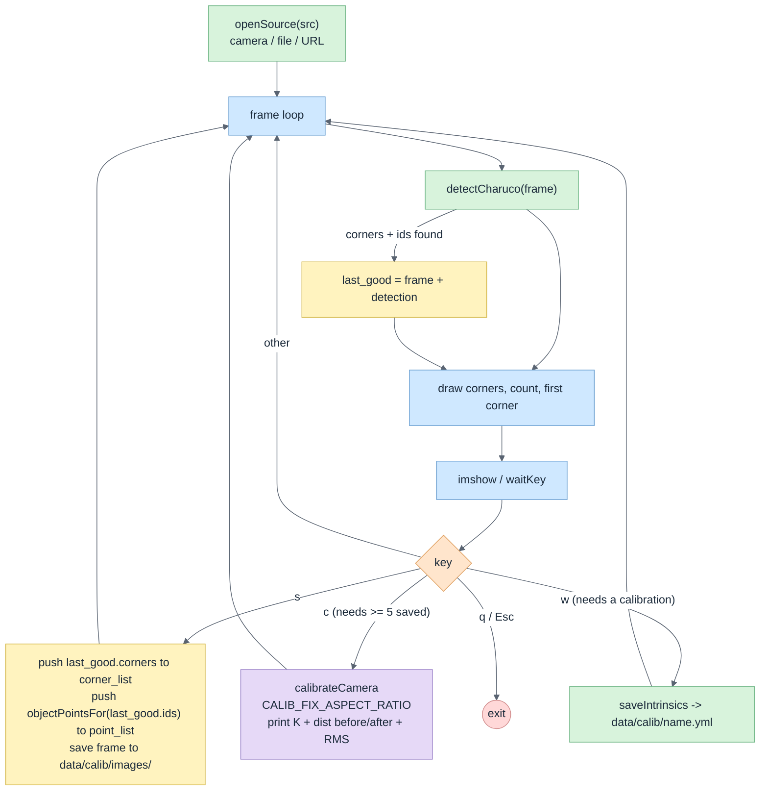
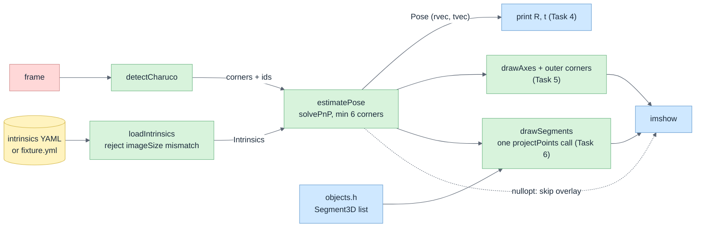
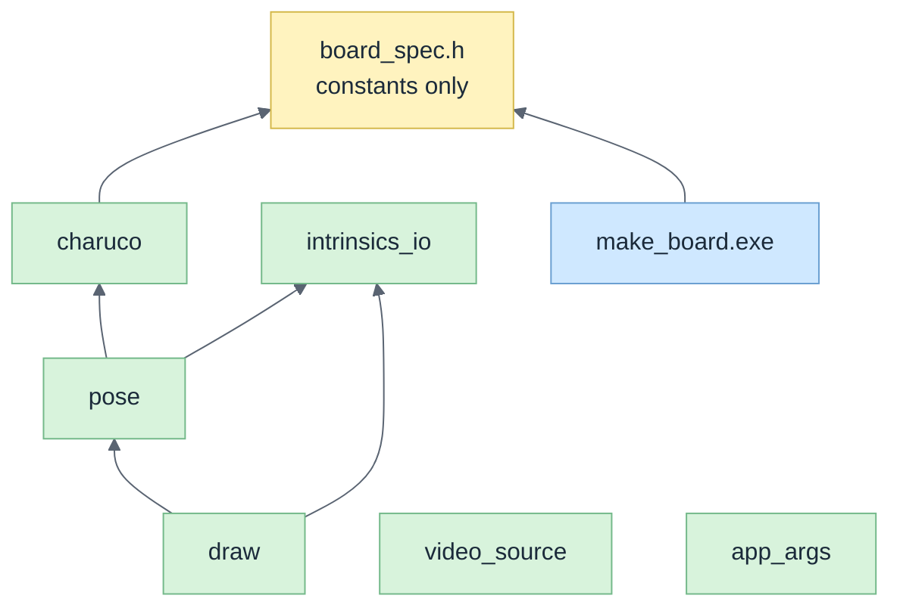
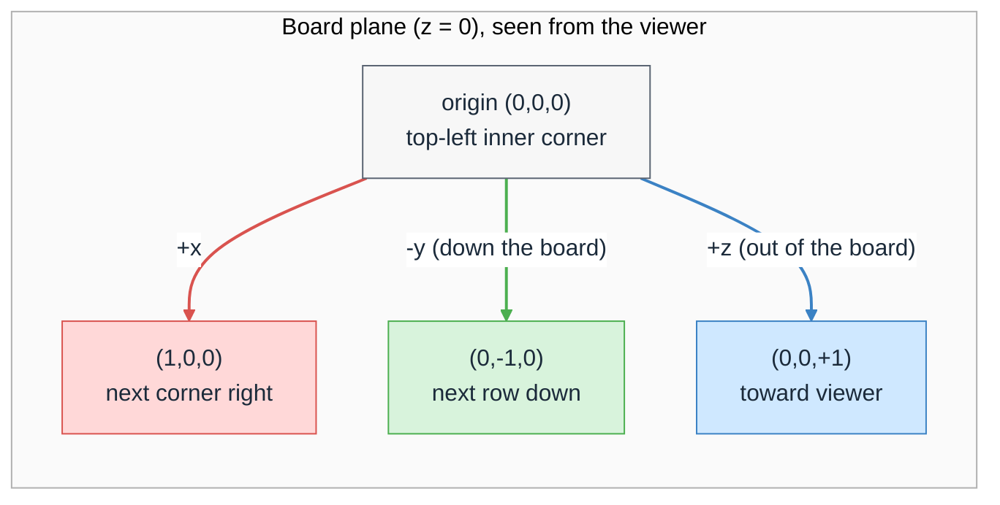

# Architecture

Deeper companion to the overview in [README.md](README.md#architecture) ([source](docs/architecture/overview.mmd)). Decisions live in [docs/mentorship/decisions.md](docs/mentorship/decisions.md); the build split is in [docs/plan/parallel-build.md](docs/plan/parallel-build.md).


## 1. calibrate: data flow (Tasks 1-3)

Why a state machine: the user presses `s` when the board may not be visible, so the app keeps the **last successful** detection and saves that, not the current frame.



ChArUco is not a checkerboard: each frame sees a different subset of corners, so `point_list[i]` is built from that frame's `ids`, never one fixed vector. `point_list[i].size() == corner_list[i].size()` holds per frame.

## 2. ar: per-frame pipeline (Tasks 4-6)



`estimatePose` returns `nullopt` when too few corners are visible, so the loop must show the raw frame in that case rather than a stale pose.

## 3. core library: module dependencies



`board_spec.h` is the single source of truth shared by `make_board` (renders) and `charuco` (detects), so the printed board and the detector cannot drift apart (D-03, D-05).

## 4. World frame (D-07)

Origin at the board's top-left inner ChArUco corner. +x right, +y up, +z toward the viewer. The next row of corners starts at `(0, -1, 0)`. "Floating above the board" means +z. OpenCV's own ChArUco corner coordinates use a different frame (y down), so `objectPointsFor` is the only allowed source of 3D board points.



Sketch of the axes (`drawAxes`: X red, Y green, Z blue):

```
        +y
         ^
         |
         o----> +x      (+z points out of the page, toward you)
   origin = top-left inner corner; row 2 is at y = -1
```

A test pins this down: a point at `(0,0,+1)` must be closer to the camera than the origin ([tests/pose_test.cpp](tests/pose_test.cpp)).

## 5. Contracts

Frozen headers; read them rather than a copy here.

| Header | Role |
| --- | --- |
| [board_spec.h](include/core/board_spec.h) | Board constants (D-03). |
| [video_source.h](include/core/video_source.h) | `openSource`: device index if all digits, else file or URL. |
| [charuco.h](include/core/charuco.h) | `detectCharuco`, `charucoBoard`, `objectPointsFor` (D-07 frame). |
| [intrinsics_io.h](include/core/intrinsics_io.h) | `Intrinsics` struct, YAML save/load. Callers must reject an `imageSize` that differs from the live frame. |
| [pose.h](include/core/pose.h) | `estimatePose` via `solvePnP`. |
| [draw.h](include/core/draw.h) | `drawAxes`, `drawSegments` (single `projectPoints` call). |
| [app_args.h](include/core/app_args.h) | Shared CLI: `<source> [--intrinsics path] [--headless] [--max-frames N]`. `--headless` skips `imshow` so apps can be verified without a window. |

## 6. Testing strategy

- Tests are GoogleTest, built as `calibar_tests`, run with `ctest --preset test` from the repo root (they open `data/` by relative path).
- A **synthetic board** ([tests/synthetic_board.h](tests/synthetic_board.h)) is rendered with the board's own `generateImage` and warped by a known `K` and pose. Detection plus `estimatePose` must recover `tvec` within 2 % and rotation within 1 degree. This tests geometry without a camera.
- `objectPointsFor` is checked against the D-07 frame (z = 0, unit spacing, `(0,-1,0)` below the origin), and +z is checked to face the camera.
- `saveIntrinsics` / `loadIntrinsics` round-trip; a missing file gives `nullopt`.
- `openSource` parsing and `app_args` are tested without opening a camera.
- Per D-06 the OpenCV-heavy core (`charuco`, `intrinsics_io`, `pose`) is hand-written by the owner against these tests (`draw` was moved to Claude by a D-06 amendment): the tests were written first and fail on the stubs by design. `video_source` and `app_args` are plain C++ and were written alongside the scaffold.
- Apps are verified headless on `data/samples/board.mp4`. Live camera behaviour (stream latency, key handling, overlay stability) can only be checked by hand.

## 7. Decisions

| ID | Topic |
| --- | --- |
| D-01 | ChArUco target |
| D-02 | Working mode (amended by D-06) |
| D-03 | Board parameters |
| D-04 | Phone camera over Wi-Fi |
| D-05 | Commit the board PNG |
| D-06 | Parallel build, hybrid ownership |
| D-07 | World frame |

Full text: [docs/mentorship/decisions.md](docs/mentorship/decisions.md).
