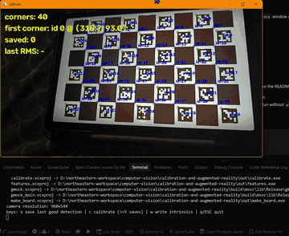
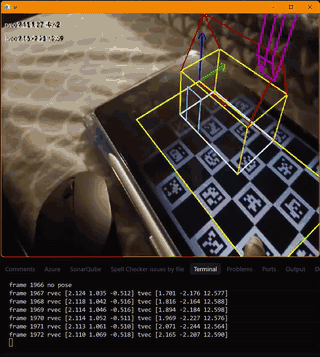
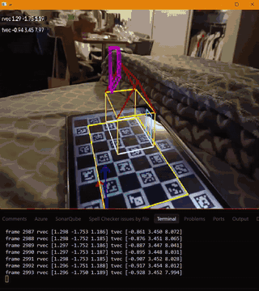
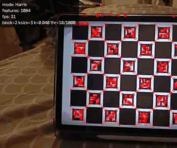
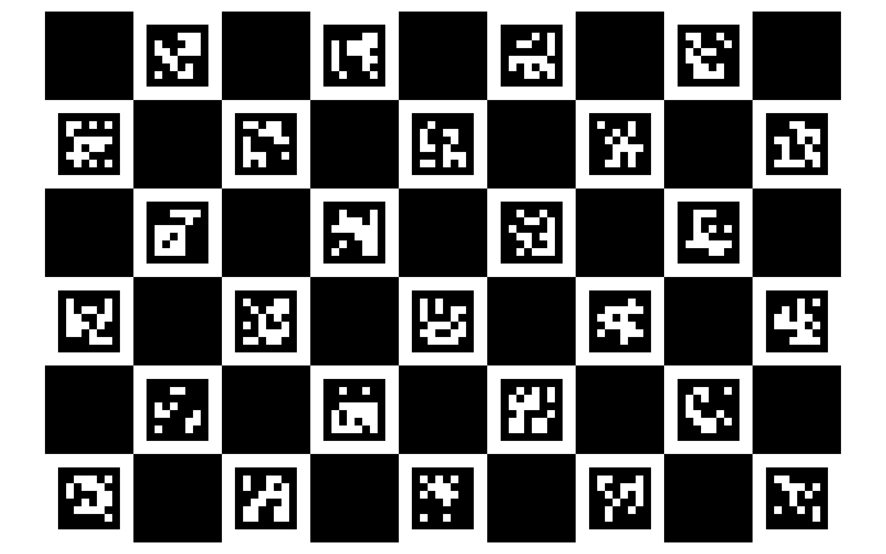
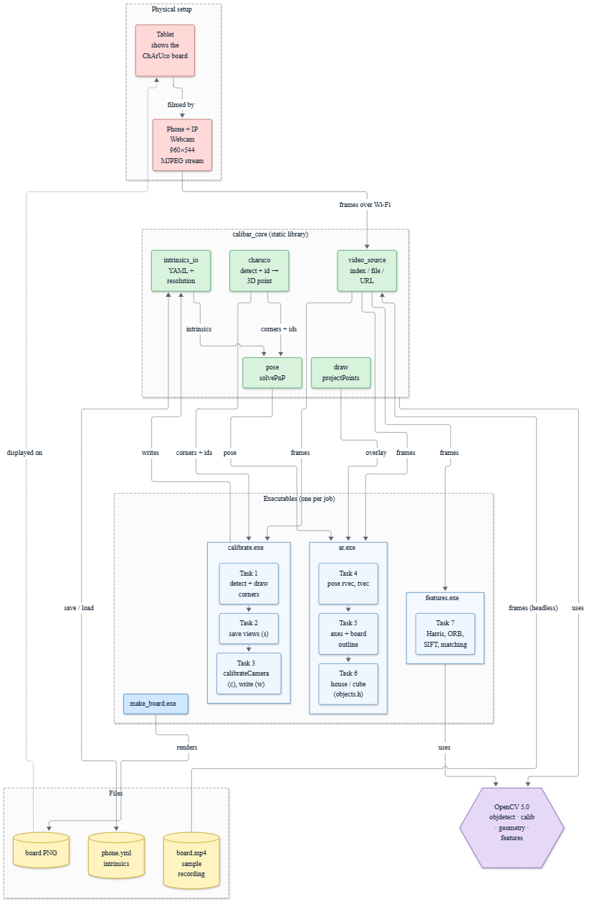

# Calibration and Augmented Reality

Point a phone at a board on a tablet, and a wireframe house appears floating above it, staying put as you walk around. This repo builds that from scratch in C++17 and OpenCV 5.0. It first works out how the phone's camera bends light (focal length, image centre, lens distortion) from a handful of views of a ChArUco board. Then, every frame, it works out where the board is relative to the camera and draws 3D objects in the right place. The phone streams to the laptop over Wi-Fi with IP Webcam, so no special hardware is needed.

What you'll find here:

- **Three apps** sharing one core library: `calibrate` (camera calibration), `ar` (pose estimation and the virtual objects) and `features` (Harris, ORB and SIFT compared live).
- **Demo videos and GIFs** of each, recorded on the live phone stream.
- **A [report](report/report.md)** with the calibration numbers, design decisions and two extensions, plus an [architecture write-up](ARCHITECTURE.md).

Built by **Supriya Kotturu** for Northeastern CS5330 (Project 4, spec in [task.md](task.md)).

## Summary

| Item | Link |
| --- | --- |
| Report | [report/report.md](report/report.md) |
| Demo videos | [Calibration](data/videos/calibration-live-stream.mp4) · [AR house](data/videos/ar-live-stream.mp4) · [AR object switching](data/videos/ar-object-switching-live-stream.mp4) (Git LFS) |
| Calibration result | 960×544 stream, fx = fy = 690.3 px, RMS **0.38 px** over 7 views ([data/calib/phone.yml](data/calib/phone.yml)) |
| Tests | 28 GoogleTest cases on a synthetic board, all passing (`ctest --preset test`) |
| Extensions | AR on pre-captured video ([video](data/videos/ext-ar-on-recorded-video.mp4)); calibration comparison of two phone camera modes ([report](report/report.md#extensions-drafted-by-claude)) |
| Time travel days used | 0 |

## Demos

<table>
  <tr>
    <td align="center"><a href="data/videos/calibration-live-stream.mp4"></a><br>Calibration (Tasks 1-3)</td>
    <td align="center"><a href="data/videos/ar-live-stream.mp4"></a><br>AR house with axes (Tasks 4-6)</td>
  </tr>
  <tr>
    <td align="center"><a href="data/videos/ar-object-switching-live-stream.mp4"></a><br>Switching objects: debug cube ↔ house (Task 6)</td>
    <td align="center"><a href="docs/images/task7-features/"></a><br>Features (Task 7)</td>
  </tr>
</table>

Click a preview for the full video (for features, the screenshot set; the preview cycles Harris → ORB → SIFT → ORB matching).

## Board



9×6 ChArUco, `DICT_6X6_250`, square 1 unit, marker 0.7, rendered for a Samsung Tab S10 FE (2304×1440) and shown full-screen at native resolution. Parameters: [include/core/board_spec.h](include/core/board_spec.h); rationale: D-03 in [docs/mentorship/decisions.md](docs/mentorship/decisions.md).

## Architecture



Source: [docs/architecture/overview.mmd](docs/architecture/overview.mmd) (Mermaid). Deeper diagrams (calibrate data flow, AR per-frame pipeline, core dependencies, world frame), contracts and test strategy: [ARCHITECTURE.md](ARCHITECTURE.md).

Four executables share one static library, `calibar_core`: `make_board` renders the board, `calibrate` covers Tasks 1-3, `ar` covers Tasks 4-6 and `features` covers Task 7. `calibrate` and `ar` communicate only through an intrinsics YAML file, which records the resolution it was made at; `ar` refuses a calibration whose resolution differs from the stream.

## Repo layout

| Path | Contents |
| --- | --- |
| `src/apps/` | One executable per job (`make_board`, `calibrate`, `ar`, `features`) |
| `src/core/`, `include/core/` | `calibar_core` static lib: board spec, ChArUco detection, intrinsics I/O, pose, drawing, video source, CLI args |
| `tests/` | GoogleTest suite with a synthetic ChArUco board |
| `data/board/` | Generated board image (D-05) |
| `data/calib/` | Intrinsics YAML: `phone.yml` (live stream), `sample_video.yml` (sample recording), `fixture.yml` (approximate, for tests) |
| `data/samples/`, `data/videos/` | Sample recording for headless runs; demo videos (Git LFS) |
| `docs/images/` | Report and README images per task, plus GIF previews (Git LFS) |
| `docs/mentorship/` | Decision log, difficulties, hints, scoreboard |
| `docs/plan/`, `docs/architecture/` | Parallel build plan; architecture diagram source and PNG |
| `report/` | Project report |

## Build and run

Requires Visual Studio 2026 and the prebuilt OpenCV 5.0 at `C:/opencv` (or set `OpenCV_DIR`). Executables land in `out/`; run them from the repo root. Use the Release build for live video; Debug is several times slower.

```sh
cmake --preset msvc
cmake --build --preset release
ctest --preset test                        # 28 tests

./out/make_board.exe                       # writes data/board/charuco_9x6_dict6x6_250.png
./out/calibrate.exe http://<phone-ip>:8080/video --intrinsics data/calib/phone.yml
./out/ar.exe http://<phone-ip>:8080/video --intrinsics data/calib/phone.yml
./out/features.exe http://<phone-ip>:8080/video

# No camera: run on the sample recording with its own calibration
./out/ar.exe data/samples/board.mp4 --intrinsics data/calib/sample_video.yml --headless
```

All apps take `<source> [--intrinsics path] [--headless] [--max-frames N]`, where `<source>` is a camera index, a video file or a stream URL ([include/core/app_args.h](include/core/app_args.h)).

| App | Keys |
| --- | --- |
| `calibrate` | `s` save last good detection · `c` calibrate (≥ 5 saves) · `w` write intrinsics · `q` quit |
| `ar` | `1` debug cube · `2` house · `a` toggle axes · `p` screenshot · `q` quit |
| `features` | `h` Harris · `o` ORB · `s` SIFT · `r` capture reference · `m` toggle ORB matching · `p` screenshot · `q` quit |

## Acknowledgements

- OpenCV 5.0 documentation and the ArUco/ChArUco calibration tutorials.
- **Claude (Anthropic)** wrote: the parallel build plan; the CMake setup and test scaffolding; the GoogleTest suite; `video_source` and `app_args`; `draw.cpp` (D-06 amendment); the `calibrate`, `ar` and `features` apps; the architecture docs and diagrams; this README; and drafted the factual sections of the report. Full breakdown: [AI usage](report/report.md#ai-usage).
- **I wrote**: all architecture decisions (D-01 to D-08); the board spec and `make_board`; the camera loop; and the core OpenCV code in `src/core/charuco.cpp`, `src/core/intrinsics_io.cpp` and `src/core/pose.cpp`. Claude reviewed that code and rewrote its comments.
