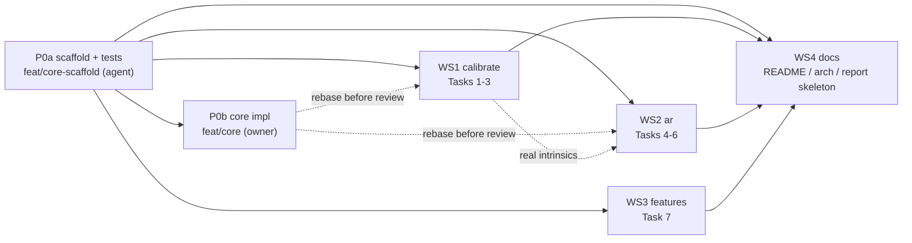

# Parallel build plan

Status: **proposed** (D-06). Readers: the owner (approves, merges) and the Sonnet agents that pick up a workstream.

## How this works

1. **Phase 0a (agent, one PR, `feat/core-scaffold`):** freeze the shared contracts: headers, stub `.cpp`s that compile but return empty/`nullopt`, every CMake target, the test suite (core tests fail against the stubs; that's expected), fixtures, and LFS rules. Nothing fans out until this is merged; that's what stops four branches fighting over `CMakeLists.txt` and inventing four different `detect()` signatures.
2. **Phase 0b (owner, by hand, `feat/core`):** the owner replaces the stubs with the real OpenCV code (D-06). The Phase 0a tests are the spec: done when `ctest` is green. Agents don't touch these files.
3. **Phase 1 (parallel, starts right after 0a merges):** one agent per workstream, each in its own git worktree and branch, each touching only the files it owns (table below). They code against the headers; WS1/WS2 can only verify headless runs once 0b is merged, so they rebase on it before opening the PR for review.
4. **Phase 2:** extensions, after the owner picks which ones (not planned here).

WS2 doesn't wait for WS1: it develops against `data/calib/fixture.yml` (approximate intrinsics) and swaps in the real file once WS1 has produced one.

## World frame (D-07)

Origin at the board's top-left inner (ChArUco) corner, **+x right, +y up, +z toward the viewer** (course convention: the next row starts at `(0, -1, 0)`). "Floating above the board" means **+z**. OpenCV's own ChArUco corner coordinates use a different frame, so `objectPointsFor` is the only allowed source of 3D board points: no caller may use the board object's internal corner coordinates directly.

## Phase 0: core contracts

Owner of each file: **agent (0a)** writes the header, stub, and tests; **owner (0b)** writes the real `.cpp` where marked.

Everything below lives in `include/core/` + `src/core/`, builds as static lib `calibar_core`, and is OpenCV 5.0 (`cv::aruco` is in `objdetect`).

| Header | Contract |
| --- | --- |
| `video_source.h` | `cv::VideoCapture openSource(const std::string& src);` device index if all digits, else file/URL (moves `isDeviceIndex` out of `calibrate.cpp`). |
| `charuco.h` | `const cv::aruco::CharucoBoard& charucoBoard();` built from `board_spec.h` + `DICT_6X6_250`. `struct CharucoDetection { std::vector<cv::Point2f> corners; std::vector<int> ids; std::vector<std::vector<cv::Point2f>> markerCorners; std::vector<int> markerIds; };` `CharucoDetection detectCharuco(const cv::Mat& frame);` `std::vector<cv::Point3f> objectPointsFor(const std::vector<int>& ids);` |
| `intrinsics_io.h` | `struct Intrinsics { cv::Mat cameraMatrix; cv::Mat distCoeffs; cv::Size imageSize; double rmsPx; int numFrames; };` `void saveIntrinsics(const std::string& path, const Intrinsics&);` `std::optional<Intrinsics> loadIntrinsics(const std::string& path);` YAML via `cv::FileStorage`. Callers must reject a file whose `imageSize` differs from the live frame. |
| `pose.h` | `struct Pose { cv::Vec3d rvec, tvec; };` `std::optional<Pose> estimatePose(const CharucoDetection&, const Intrinsics&, int minCorners = 6);` (`solvePnP`, `SOLVEPNP_ITERATIVE`). |
| `draw.h` | `struct Segment3D { cv::Point3f a, b; cv::Scalar color; };` `void drawAxes(cv::Mat&, const Pose&, const Intrinsics&, float length);` `void drawSegments(cv::Mat&, const std::vector<Segment3D>&, const Pose&, const Intrinsics&, int thickness = 2);` (one `projectPoints` call for all endpoints). |
| `app_args.h` | Shared CLI: `<source> [--intrinsics path] [--headless] [--max-frames N]`. `--headless` = no `imshow`/`waitKey`; run through a file source, print stats, exit 0. Agents can't click a window, so this is how they verify apps. |

**ChArUco ≠ checkerboard for Task 2.** Each frame sees a different subset of corners, so `point_set` is built per save from that frame's `ids` (`objectPointsFor(ids)`), not one fixed vector. `point_set.size() == corner_set.size()` still holds per frame.

**Who implements what:** owner (0b) writes `charuco.cpp`, `intrinsics_io.cpp`, `pose.cpp`, `draw.cpp`. The agent (0a) fully implements `video_source.cpp` and `app_args.cpp` (plain C++, no learning value) and leaves stubs for the rest.

**CMake:** add `calibar_core`; add targets `calibrate`, `ar`, `features` (stub `main`s for the last two); add `tests/` with GoogleTest via `FetchContent` pinned to a release tag + `enable_testing()` + `gtest_discover_tests`; add a `test` preset to `CMakePresets.json`.

**Sample video:** `data/samples/board.mp4` (Git LFS, already on `main`): the board moved around, partial views included. Headless runs use it; read its resolution with `CAP_PROP_FRAME_WIDTH/HEIGHT` rather than assuming it (it is 1080×1920 portrait).

**Tests (written in 0a, fail on stubs, must pass after 0b):**

- Synthetic board: render with `charucoBoard().generateImage`, warp with a known `K` and pose (`projectPoints` the 4 outer corners → `getPerspectiveTransform` → `warpPerspective`), detect, `estimatePose`, assert recovered `tvec` within 2 % and rotation within 1°.
- `objectPointsFor` returns `z == 0`, spacing `kSquareLength`, first corner at `(0,0,0)`, the corner below it at `(0,-1,0)` (D-07).
- Synthetic board: a point at `(0,0,+1)` projects toward the camera (its depth in the camera frame is smaller than the origin's), proving +z faces the viewer.
- `saveIntrinsics` → `loadIntrinsics` round-trips; missing file → `nullopt`.
- `openSource("0")` takes the device path, `openSource("x.mp4")` the file path (test the parser, not the camera).

**Fixtures:** `data/calib/fixture.yml` (fx = fy = 0.9 × width, principal point at centre, zero distortion, at the sample video's 1080×1920 portrait resolution).

## Phase 1: workstreams

| WS | Branch | Owns (only these files) | Task(s) | Done when |
| --- | --- | --- | --- | --- |
| WS1 | `feat/calibrate` | `src/apps/calibrate.cpp`, `src/apps/calibrate/*` | 1–3 | Live corner overlay + count + first corner printed; `s` saves last *successful* detection (and frame to `data/calib/images/`); `c` calibrates when ≥ 5 saved, printing K + dist before/after + RMS; `w` writes `data/calib/<name>.yml`; `CALIB_FIX_ASPECT_RATIO`; headless run on a sample video exits 0. |
| WS2 | `feat/ar` | `src/apps/ar.cpp`, `src/apps/ar/*`, `include/core/objects.h`, `src/core/objects.cpp` | 4–6 | Prints R/t per frame; draws 3D axes + projected outer board corners; asymmetric multi-colour line object floating above the board (`objects.h` returns `std::vector<Segment3D>`); headless run exits 0. |
| WS3 | `feat/features` | `src/apps/features.cpp`, `src/apps/features/*` | 7 | Live Harris (trackbars: blockSize, ksize, k, threshold) and ORB (nfeatures, fastThreshold) with key toggle; FPS + count overlay; headless run exits 0. |
| WS4 | `docs/architecture` | `README.md`, `ARCHITECTURE.md`, `docs/architecture/*`, `report/*` | — | Mermaid + PNG side by side (pastel per component type, boxes per executable, labelled arrows, one box per task 1–7); ARCHITECTURE.md; report **skeleton only** (headings + TODOs; the owner writes the prose). Rebase last. |

Files nobody in Phase 1 may edit: `CMakeLists.txt`, `CMakePresets.json`, `include/core/*` (except WS2's `objects.h`), `src/core/*` (except WS2's `objects.cpp`), `docs/mentorship/*`. If a contract is wrong, stop and say so in the PR; don't patch it on your branch.

## Rules for every agent

- **Setup:** own worktree, branch from latest `main`. Build: `cmake --preset msvc` then `cmake --build --preset debug`. Test: `ctest --preset test`. Run from repo root; exes land in `out/`.
- **Toolchain:** Windows, MSVC (VS 2026), prebuilt OpenCV 5.0 at `C:/opencv`. No MinGW.
- **File header:** every new `.cpp`/`.h` starts with the Author / Date / Purpose block used in `board_spec.h` (Author: Sai Supriya Kotturu).
- **Style:** `.clang-format` in repo; C++17; comments say *why*, not *how*. `camera_matrix` is `CV_64F`; never `at<float>` it.
- **Commits:** `type(scope): :gitmoji: subject`, subject says why. No Co-Authored-By, no "Generated with" footer, in commits or PRs.
- **Decisions:** don't edit `decisions.md`. Put any design choice in the PR body under **Decisions** (options, trade-offs, choice); the owner moves it into the log. Reserved IDs so they don't collide: WS1 D-1x, WS2 D-2x, WS3 D-3x, WS4 D-4x.
- **PR body:** What / Why / Decisions / How verified (build, ctest, headless run output) / What the owner must check by hand with the camera.
- **No camera:** you can't verify live behaviour. Say so in the PR rather than claiming it works.

## Merge order

P0a → P0b → (WS1, WS2, WS3 in any order; WS3 can merge before P0b since it doesn't use the core) → WS4 rebased on all three. WS2 switches from `fixture.yml` to a real intrinsics file in a follow-up once WS1 has been run on the real camera.
